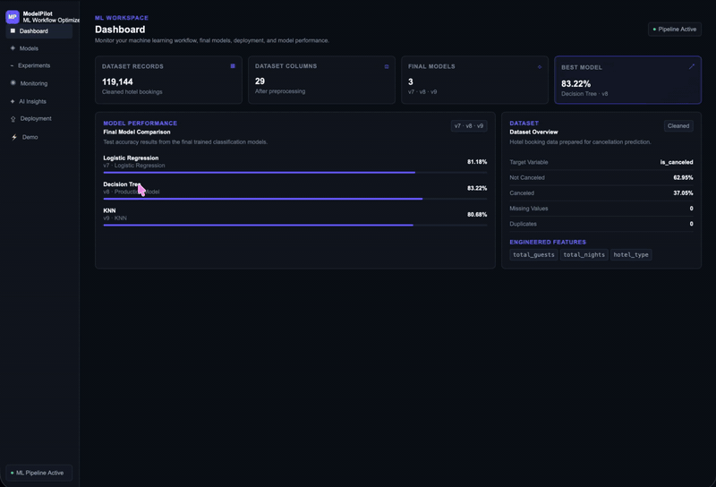

Machine Learning team project for COSC 472 at Morgan State University

# Project Title: ML Workflow Optimizer

> ML Workflow Optimizer is an AI-powered developer tool designed to streamline model deployment, model monitoring, experiment tracking, and hyperparameter optimization. Built with Python, Flask, D3.js, scikit-learn, and the Anthropic API, the platform provides interactive model visualizations and AI-driven insights to simplify the machine learning workflow. The project uses hotel booking cancellation prediction as a real-world use case to demonstrate the ML workflow.

## 👥 Team Members & Contributions

As per course requirements, all three members actively collaborate and commit to this repository.

* **Taniyah Payton (tapay9)** - Data Engineering, AI Integration & Application Development
* **Isaac Rankin (themaxhat)** - Model Training, Experiment Tracking & Monitoring
* **Tariq Lukis (taluk1)** - Model Evaluation, Optimization & Deployment

---

## 🚀 Live Demo

* **Application URL:** Coming Soon
* *The live demo will be fully functional and accessible during the live project presentation.*

### 🎥 Project Walkthrough



*The `demo.gif` will be added before the final submission deadline.*

---

## 🛠️ Installation & Setup

Follow these steps to set up the environment and run the project locally.

### Prerequisites

* Python 3.10+
* `pip`
* Git
* Anthropic API key for AI-powered features

### Local Installation

```bash
# Clone the repository
git clone https://github.com/tapay9/ML_Workflow_Optimizer.git
cd ML_Workflow_Optimizer

# Create a virtual environment
python3 -m venv venv
source venv/bin/activate

# Install required dependencies
pip install -r requirements.txt

# Run the Flask application
python3 app/app.py
```

Create a `.env` file in the root directory and add your Anthropic API key:

```text
ANTHROPIC_API_KEY=your_api_key_here
```

The `.env` file should not be committed to GitHub.

---

## 📊 Dataset

* **Source:** Kaggle - Hotel Booking Reservation Dataset
* **Description:** The project uses hotel booking data to predict whether a reservation will be canceled. The target variable is `is_canceled`, where `0` represents a non-canceled booking and `1` represents a canceled booking. After preprocessing, the dataset contains 119,144 records and 29 columns.
* **Data Pipeline:** The preprocessing pipeline handles missing values, removes duplicate and leakage-related data, creates additional features such as total guests and total nights, and prepares the cleaned dataset for model training. The processed dataset is stored as `data/hotel_bookings_cleaned.csv`.

---

## 🧠 Model Architecture & Training

* **Algorithms:** Logistic Regression, Decision Tree, and K-Nearest Neighbors (KNN)
* **Frameworks Used:** Python, pandas, NumPy, and scikit-learn
* **Training Process:** Multiple classification models were trained using the cleaned hotel booking dataset to predict booking cancellations. The models are compared using training and test performance as well as classification metrics. Additional experiments evaluate hyperparameters, training-data percentages, and train/test splits to investigate and reduce overfitting.

---

## 📈 Evaluation & Results

The baseline models were evaluated using accuracy, Macro F1-score, ROC-AUC, and the difference between training and test accuracy.

| Model | Test Accuracy | Macro F1 | ROC-AUC | Train/Test Gap |
| :--- | :---: | :---: | :---: | :---: |
| Logistic Regression | 81.14% | 0.7877 | 0.8879 | 0.01% |
| Decision Tree | 81.89% | 0.8063 | 0.8070 | 18.11% |
| K-Nearest Neighbors | 77.94% | 0.7590 | 0.8426 | 7.51% |

Although the Decision Tree achieved the highest baseline test accuracy, its large train/test gap indicates overfitting. Logistic Regression demonstrates stronger generalization and the highest ROC-AUC of the baseline models.

The application also includes D3.js model-monitoring visualizations and Anthropic-powered AI analysis. Anthropic provides model performance insights, optimization and hyperparameter recommendations, and deployment-readiness feedback based on the available model results.

Additional model analysis outputs, including confusion matrices, ROC/PR curves, feature significance results, and experiment results, are stored under `src/analysis_output/`.

---

## 🧑‍💻 Git Workflow & Guidelines

To maintain collaboration integrity, remember to:

1. **Branch Frequently:** Create feature branches (`git switch -c feature/your-feature`).
2. **Commit Regularly:** Write descriptive commit messages for completed features and updates.
3. **Pull Before Push:** Pull the latest changes from `main` before beginning new work (`git pull origin main`).
